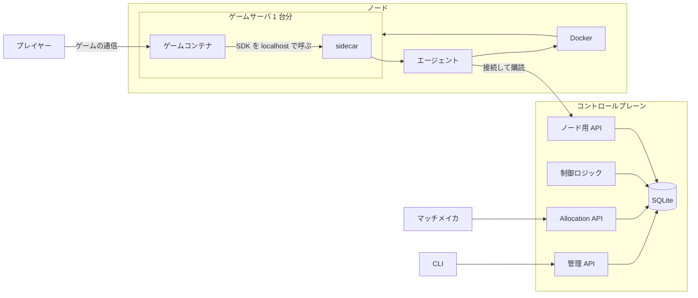
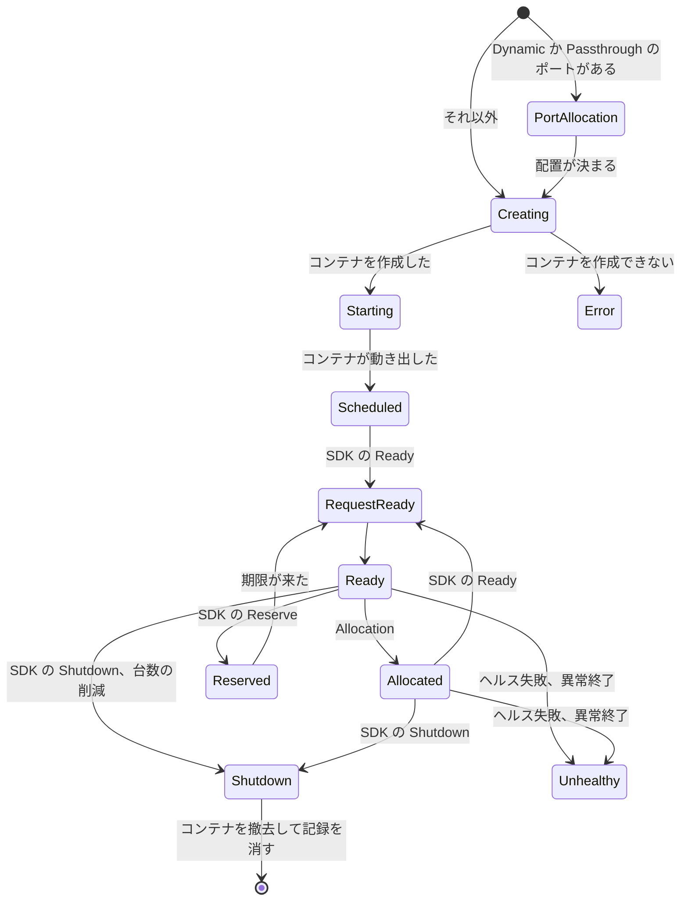
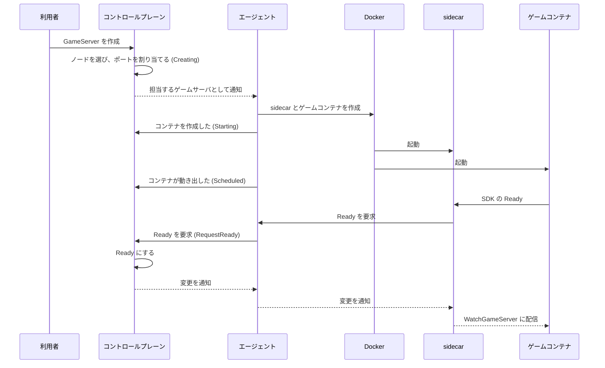

# agones-lite 設計書

この文書は、agones-lite の作り方を定める。
何を作り、何を作らないかは [企画書](planning.md) に書いた。

互換の基準は Agones v1.62.0 である。
本文で「本家」と書いたときは、このバージョンの Agones を指す。
本家のファイルは、submodule として置いた `third_party/agones` からの相対パスで示す。

## 全体の構成

agones-lite は 4 つの部品でできている。

- **コントロールプレーン**：状態を保存し、あるべき状態を決める。管理 API、Allocation API、ノード用 API を提供する。`agones-lite server` で起動する。
- **エージェント**：各ノードで動き、そのノードが担当するゲームサーバのコンテナを Docker に作らせ、結果を報告する。`agones-lite agent` で起動する。
- **sidecar**：ゲームサーバ 1 台につき 1 つ動く小さなコンテナで、ゲームサーバが SDK で話す相手になる。
- **CLI**：管理 API を呼ぶコマンド群で、本体と同じバイナリに入っている。



コントロールプレーンは 1 台だけ置く。
`agones-lite server` は既定でエージェントを同じプロセスの中で動かすので、VM が 1 台ならこれだけで足りる。
ノードを増やすときは、追加の VM で `agones-lite agent` を起動する。

通信の向きは、すべてノードの内側から外側へ向かう。
sidecar はエージェントに接続し、エージェントはコントロールプレーンに接続する。
コントロールプレーンからノードへ接続することはないので、ノード側で受信ポートを開ける必要があるのはゲームの通信だけになる。

## Kubernetes の仕事を何で置き換えるか

本家は多くの仕事を Kubernetes に任せている。
agones-lite はそれを次のように置き換える。

| 仕事 | 本家での担い手 | agones-lite での担い手 |
|---|---|---|
| リソースの保存と楽観ロック | API サーバと etcd | SQLite とメモリ上の写し（`pkg/store`） |
| 変更の通知 | informer | store の購読 |
| 重複を除いた再試行つきの作業キュー | client-go の workqueue | `pkg/queue` |
| 既定値の付与と検証 | admission webhook | 管理 API のハンドラが型のメソッドを直接呼ぶ |
| ノードの選択 | kube-scheduler | `pkg/scheduling` |
| ポートの衝突回避 | kube-scheduler と portallocator | `pkg/portallocator` |
| コンテナの起動と監視 | kubelet | エージェント（`pkg/agent`）と Docker |
| Pod | Pod | sidecar コンテナ 1 つとゲームコンテナ群 |
| 親子関係と連鎖削除 | ownerReference とガベージコレクタ | ownerReference を保持し、子の制御が親の消失を見て自分を消す |
| 削除の後始末 | finalizer | 削除要求の印を付け、コンテナの撤去を確認してから記録を消す |
| 出来事の記録 | Event | イベント履歴（`pkg/events`） |
| ノードの台帳 | Node | agones-lite 独自の Node リソース |

## リソースモデル

リソースの型は本家の Go 型をそのまま使う。
GameServer、GameServerSet、Fleet は `agones.dev/agones/pkg/apis/agones/v1` の型、FleetAutoscaler は `pkg/apis/autoscaling/v1` の型である。
JSON の形が本家と同じになるので、本家向けの YAML をそのまま読める。

`metadata` の各項目は次のように扱う。

| 項目 | 扱い |
|---|---|
| `name`、`generateName` | 本家と同じ。`generateName` だけが指定されたら末尾に乱数を付ける |
| `namespace` | 名前の区画として保持する。省略時は `default` |
| `uid` | 作成時に生成する |
| `resourceVersion` | store の版番号。更新時に一致しなければ競合として拒否する |
| `generation` | `spec` が変わるたびに 1 増やす |
| `creationTimestamp` | 作成時に記録する |
| `deletionTimestamp` | 削除要求を受けたときに記録する。記録は後始末が済んでから消す |
| `labels`、`annotations` | 本家と同じ |
| `ownerReferences` | Fleet と GameServerSet、GameServerSet と GameServer の親子関係を表す |

GameServerAllocation は保存しない。
Allocation API のリクエストとして受け取り、結果を応答として返すだけである。

### Node リソース

本家にないリソースとして **Node** を追加する。
エージェントが接続したときにコントロールプレーンが作り、ノードの容量と状態を表す。

```yaml
apiVersion: agones-lite/v1
kind: Node
metadata:
  name: node-1
spec:
  unschedulable: false        # cordon すると true になる
  drain: false                # drain すると true になる
status:
  phase: Ready                # Ready または Disconnected
  address: 203.0.113.10       # プレイヤーが接続するアドレス
  capacity:
    cpu: "8"
    memory: 16Gi
  maxGameServers: 100
  portRange: {min: 7000, max: 8000}
  lastHeartbeatTime: "2026-11-23T10:00:00Z"
  version: v1.0.0
```

### 既定値の付与と検証

管理 API は、受け取ったリソースに対して型のメソッド `ApplyDefaults()` と `Validate()` を呼ぶ。
本家では admission webhook が同じメソッドを呼んでいるので、判定の結果は本家と一致する。

`Validate()` には、クラウド製品ごとの追加検証を差し込むための `APIHooks` を渡す必要がある。
agones-lite は、何も検証しない実装を渡す。

本家の型のメソッドは feature gate を参照する。
本家の feature gate は、初期化しないとすべて無効として扱われる（`pkg/util/runtime/features.go` の `FeatureEnabled`）。
agones-lite は起動時に `ParseFeatures("")` を呼び、v1.62.0 の既定値で固定する。
利用者が gate を切り替える手段は用意しない。

### Pod 定義のうち対応する範囲

本家の GameServer は、`spec.template` に Kubernetes の Pod 定義を丸ごと持つ。
Docker で表現できるのはその一部なので、項目を 3 つに分けて扱う。

次の項目は解釈して実行に反映する。

| 項目 | Docker での表現 |
|---|---|
| `containers[].name`、`image`、`command`、`args`、`workingDir` | コンテナの同名の設定 |
| `containers[].env`（値を直接書いたもの） | 環境変数 |
| `containers[].ports` | ポートポリシーに従って公開する |
| `containers[].resources`（`cpu` と `memory`） | `limits` は CPU とメモリの制限にする。`requests` はノード選択の計算にだけ使う |
| `containers[].volumeMounts` と `volumes[]`（`emptyDir`、`hostPath`） | `emptyDir` はゲームサーバごとのボリューム、`hostPath` はバインドマウント |
| `containers[].imagePullPolicy` | イメージを取得するかどうかの判断 |
| `containers[].securityContext` の `runAsUser`、`runAsGroup`、`readOnlyRootFilesystem` | コンテナの同等の設定 |
| `terminationGracePeriodSeconds` | 停止時に強制終了するまでの猶予 |

Pod テンプレートの `metadata`（ラベルとアノテーション）は、そのまま保持する。
実行には影響しない。

次の項目は、無視しても実行内容が変わらないので、警告を返して無視する。

- `nodeSelector`、`affinity`、`tolerations`、`topologySpreadConstraints`、`schedulerName`、`priorityClassName`
- `serviceAccountName`、`automountServiceAccountToken`
- `imagePullSecrets`（イメージ取得の認証は各ノードの Docker の設定に従う）
- `restartPolicy`（コンテナは常に再起動しない）
- GameServer の `spec.eviction`

上のどちらにも挙げていない項目が指定されていたら、エラーとして拒否する。
無視すると挙動が変わるためである。
代表的なものを挙げる。

- `initContainers`、`ephemeralContainers`
- `emptyDir` と `hostPath` 以外のボリューム
- `env[].valueFrom`、`envFrom`
- `livenessProbe`、`readinessProbe`、`startupProbe`、`lifecycle`
- `hostNetwork`、`hostPID`、`hostIPC`、`shareProcessNamespace`
- `securityContext.privileged`
- `cpu` と `memory` 以外の資源

FleetAutoscaler の Webhook ポリシーは `url` による指定だけに対応する。
Kubernetes の Service を指す `service` による指定は拒否する。

## 状態の保存と変更の通知

状態は `pkg/store` が管理する。
store は SQLite のファイルと、その内容をすべて載せたメモリ上の写しを持つ。

読み取りはメモリ上の写しから行う。
プロセスは 1 つなので、すべての書き込みが store を通るかぎり、写しは SQLite と食い違わない。

### 2 種類の読み取り

読み取りには 2 つの形がある。

- **Get と List**：呼び出し側だけの複製を返す。受け取ったものは自由に書き換えられ、そのまま更新に使える。
- **View**：保存されているオブジェクトそのものを、複製せずに返す。読むだけに使い、書き換えるわけにはいかない。

View は性能のためにある。
Allocation や各制御は、変更があるたびにゲームサーバ全体を見渡す。
最初の実装は List だけを持ち、そのたびに全台を複製していた。
負荷試験にかけると、1,000 台が Ready になるまでに 1 分半かかり、割り当ての応答は秒の単位になった。
全体を見渡す箇所を View に切り替えると、それぞれ約 1 秒と数ミリ秒になった。

View を安全にしているのは、store が保存済みのオブジェクトを書き換えないことである。
更新は、新しいオブジェクトへの差し替えとして行う。
そのため、以前に取った View は、取った時点の姿を示し続ける。

### 書き込み

書き込みは次の順に進む。

1. store 全体のロックを取る。
2. 渡されたリソースの `resourceVersion` が現在の版と一致するか確かめる。一致しなければ競合エラーを返す。
3. 版番号を 1 進め、SQLite に 1 トランザクションで書く。
4. メモリ上の写しを差し替える。
5. 購読者に変更を通知する。

版番号は store 全体で 1 本の通し番号にする。
リソースごとに番号を持つより単純で、変更の前後関係がそのまま番号の大小になる。

「読んで、変えて、書く」という一連の操作には `Change` を使う。
`Change` は、書く時点で他の誰かが先に更新していたら、読むところからやり直す。
制御のコードは、競合の処理を自分で書かずに済む。

削除には 2 つの操作がある。
`MarkDeleted` は「消してよい」という印（`deletionTimestamp`）を付けるだけで、記録は残す。
その記録を持つ制御が後始末を済ませてから、`Delete` で記録を消す。
Kubernetes の finalizer と同じ役割である。

store の Go のインタフェースは、種類ごとの型を付けた次の形で使う。

```go
func (t Typed[T]) Get(namespace, name string) (T, bool)
func (t Typed[T]) List(namespace string) []T // private copies, sorted by name
func (t Typed[T]) View(namespace string) []T // shared with the store: read only
func (t Typed[T]) Create(obj T) (T, error)
func (t Typed[T]) Update(obj T) (T, error) // ErrConflict on a stale resourceVersion
func (t Typed[T]) Change(namespace, name string, change func(T) (keep bool)) error
func (t Typed[T]) MarkDeleted(namespace, name string, now time.Time) error
func (t Typed[T]) Delete(namespace, name string) error
func (t Typed[T]) Watch() (events <-chan Event, cancel func())
func (t Typed[T]) ListAndWatch(namespace string) (objects []T, events <-chan Event, cancel func())
```

### SQLite のテーブル

テーブルは 3 つある。
リソース本体と版番号は `pkg/store` が、イベント履歴は `pkg/events` が、同じファイルの中に持つ。

```sql
-- リソース本体。data は本家互換の JSON
CREATE TABLE resources (
  kind      TEXT    NOT NULL,
  namespace TEXT    NOT NULL,
  name      TEXT    NOT NULL,
  version   INTEGER NOT NULL,
  data      BLOB    NOT NULL,
  PRIMARY KEY (kind, namespace, name)
);

-- 版番号
CREATE TABLE meta (
  key   TEXT PRIMARY KEY,
  value BLOB NOT NULL
);

-- イベント履歴。24 時間たったものを消す
CREATE TABLE events (
  id        INTEGER PRIMARY KEY AUTOINCREMENT,
  time      INTEGER NOT NULL,
  kind      TEXT NOT NULL,
  namespace TEXT NOT NULL,
  name      TEXT NOT NULL,
  type      TEXT NOT NULL,   -- Normal または Warning
  reason    TEXT NOT NULL,
  message   TEXT NOT NULL
);
```

SQLite は WAL モードで開き、リソースの書き込みはコミットのたびにディスクへ同期させる。
同期を省くと、電源断の直前に行った割り当てが失われ、対戦中のゲームサーバがもう一度割り当てられるおそれがある。

## 制御ロジックの書き方

Fleet の台数を保つ、ゲームサーバを起動する、といった「あるべき状態に合わせ込む」処理を **制御** と呼ぶ。
agones-lite の制御は、どれも同じ 2 層の形で書く。

- **判断**：現在の状態を引数で受け取り、行うべき操作の一覧を返す純粋関数。store も Docker も時計も触らない。現在時刻が要るなら引数で受け取る。
- **実行**：store から状態を読んで判断の関数に渡し、返ってきた操作を順に実行する薄い層。

GameServerSet の台数を保つ制御を例にすると、判断は次のような関数になる。

```go
// Plan decides how to move a GameServerSet toward its desired replicas.
// It only looks at its arguments, so tests need no store and no Docker.
func Plan(set *agonesv1.GameServerSet, servers []*agonesv1.GameServer) Actions {
	alive, dead := split(servers)
	missing := int(set.Spec.Replicas) - len(alive)
	if missing >= 0 {
		return Actions{Create: missing, Delete: dead}
	}
	return Actions{Delete: append(dead, pickForRemoval(set, alive, -missing)...)}
}
```

本家は、イベントハンドラと作業キューを中心にした非同期の構造の中に、判断と実行を混ぜて書いている。
分けて書くと、判断の部分を上から下へ読めるようになり、表形式のテストだけで検証できる。
本家にも同じ考え方の関数があり（`pkg/gameserversets/controller.go` の `computeReconciliationAction`）、agones-lite はそれを全体の規則にする。

実行の層を起動するきっかけは 2 つある。
1 つは store の変更通知で、関係するリソースのキーを `pkg/queue` に積む。
もう 1 つは 30 秒ごとの定期的な再確認で、すべてのキーを積み直す。
通知を取りこぼしても、次の再確認で状態は収束する。

`pkg/queue` は、同じキーの重複を 1 つにまとめ、失敗したキーを間隔を空けて再試行する。
標準ライブラリだけで書く。

きっかけの部分はどの制御でも同じなので、`pkg/control` に 1 回だけ書いてある。
各制御は、どの種類の変更を聞くかと、変更がどのリソースに関わるかを渡すだけでよい。

## GameServer のライフサイクル

GameServer の状態は、本家と同じ 11 種類である（`pkg/apis/agones/v1/gameserver.go` の 43 行から 68 行）。



図には主な経路だけを描いた。
SDK からの要求は、本家と同じく、遷移元の状態を問わずに受け付ける。
受け付けないのは、削除中のときと、すでに Unhealthy のときだけである。

### 遷移を起こす出来事

状態を変えるのはコントロールプレーンだけである。
エージェントと sidecar は「何が起きたか」を報告し、コントロールプレーンがそれを遷移に変える。

| 出来事 | 報告元 | 遷移 |
|---|---|---|
| 配置が決まった | コントロールプレーン | PortAllocation から Creating へ。`status.nodeName` と、各ポートの `hostPort` を埋める |
| コンテナを作成した | エージェント | Creating から Starting へ |
| コンテナを作成できなかった | エージェント | Creating から Error へ |
| コンテナが動き出した | エージェント | Starting から Scheduled へ。`status.address` と `status.ports` を埋める |
| SDK の Ready | sidecar | RequestReady へ。続けてコントロールプレーンが Ready にする |
| SDK の Allocate | sidecar | Allocated へ |
| Allocation API による割り当て | コントロールプレーン | Ready から Allocated へ |
| SDK の Reserve | sidecar | Reserved へ。`status.reservedUntil` を埋める |
| SDK の Shutdown | sidecar | Shutdown へ |
| 台数の削減、drain | コントロールプレーン | Shutdown へ。Allocated と Reserved には効かない |
| コンテナが終了コード 0 で終わった | エージェント | Shutdown へ |
| コンテナが 0 以外で終わった | エージェント | Unhealthy へ |
| コンテナが見当たらない | エージェント | Unhealthy へ |
| ヘルスチェックに失敗した | sidecar | Unhealthy へ |
| ノードを失った | コントロールプレーン | Unhealthy へ |

この表は、そのまま 1 つの純粋関数になる。

```go
// Next returns the state a GameServer moves to when an event arrives.
// Pairs that are not listed are ignored, so late or repeated events are harmless.
func Next(current agonesv1.GameServerState, e Event) (agonesv1.GameServerState, bool)
```

### 起動から Ready まで



### 配置を待つ場合

条件を満たすノードがないとき、GameServer を Error にはしない。
`status.nodeName` を空にしたまま待たせ、イベント履歴に理由を残す。
ノードの追加やゲームサーバの終了で空きができると、次の再確認で配置される。
Kubernetes で Pod が Pending のまま待つのと同じ挙動である。

### 削除

削除は 2 段階で進む。
まず削除要求を受けたときに `deletionTimestamp` を記録する。
担当のエージェントはそれを見てコンテナを止めて撤去し、撤去したことを報告する。
コントロールプレーンは報告を受けてから記録を消す。
ノードが決まる前の GameServer は、コンテナがないのですぐに記録を消す。
担当のノードに届かないとき（接続が切れている、または削除された）も、報告を待たずに記録を消す。
そのノードが戻ってくれば、エージェントが担当一覧にないコンテナとして撤去する。

Shutdown になった GameServer は、コントロールプレーンが削除要求を出す。
Unhealthy や Error になった単体の GameServer は、本家と同じく自動では消さない。
GameServerSet に属するものは、GameServerSet の制御が消して作り直す。

### 本家と異なる点

状態と遷移は本家と同じだが、遷移のきっかけには次の違いがある。

**配置とポート割り当てを同時に行う**：本家は、まずポートを割り当ててから Pod を作り、どのノードに置くかは kube-scheduler に任せる。
agones-lite は、ノードを選ぶのと同時に、そのノードで実際に空いているポートを割り当てる。

**ヘルス判定を始める合図**：本家の sidecar は、kubelet からの最初の生存確認（`/gshealthz`）を受けたときにヘルス判定を始める。
agones-lite には kubelet がないので、sidecar が起動してから `spec.health.initialDelaySeconds` が過ぎたときに始める。

**コンテナを再起動しない**：ゲームコンテナが終了したら、終了コードに応じて Shutdown か Unhealthy にする。
v1.62.0 の既定の設定（feature gate の SidecarContainers が有効）での本家の挙動に合わせている。

## ノードの選択とポートの割り当て

GameServer をどのノードに置くかは `pkg/scheduling` が決める。
これも純粋関数で、GameServer と、全ノードと、配置済みの全 GameServer を受け取り、ノードと割り当てるポートを返す。

ノードは 2 段階で選ぶ。
最初に、置けないノードを除く。

- 接続が切れているノード
- cordon されているノード
- 配置済みの GameServer の `requests` の合計にこの GameServer の分を足すと、CPU かメモリの容量を超えるノード
- 配置済みの台数が `maxGameServers` に達しているノード
- Static ポリシーで指定されたポートがすでに使われているノード
- Dynamic と Passthrough のポートに必要な数の空きが、ポート範囲に残っていないノード

次に、残ったノードから `spec.scheduling` に従って 1 つ選ぶ。
**Packed** ならゲームサーバが最も多いノードを、**Distributed** なら最も少ないノードを選ぶ。
同数ならノード名の順で決める。
本家の Packed は Pod のアフィニティで同じ効果を得ている（`pkg/apis/agones/v1/gameserver.go` の `Pod()` が設定する）。

`requests` を書いていないコンテナは、容量を消費しないものとして数える。
その場合に詰め込みすぎを防ぐのは `maxGameServers` だけになる。

### ポートの割り当て

ポートポリシーは本家と同じ 4 種類である。

| ポリシー | 割り当て |
|---|---|
| Static | 定義に書かれた `hostPort` をそのまま使う |
| Dynamic | ノードのポート範囲から空きを選んで `hostPort` にする |
| Passthrough | 空きを選び、`hostPort` と `containerPort` の両方に同じ値を使う |
| None | 公開しない。`status.ports` には `containerPort` を載せる |

`protocol` が TCPUDP のポートは、本家と同じく TCP 用と UDP 用の 2 つに展開する（`pkg/portallocator/portallocator.go`）。

どのポートが使用中かは、どこにも保存しない。
配置済みの GameServer の `status.nodeName` と、各ポートの `hostPort` から、そのつど計算する。
状態を二重に持たないので、解放を忘れることも、数え間違えることもない。

本家の portallocator は、ノードごとの「枠」を持つが、実際にどのノードに置くかは kube-scheduler に任せている。
agones-lite ではノードを自分で決めるので、割り当ての仕組みは書き直す。

## エージェントと Docker

エージェントは、担当する GameServer の一覧（あるべき状態）と、Docker 上のコンテナの一覧（実際の状態）を見比べ、差を埋める。
この判断も純粋関数にする。

```go
// Plan compares the GameServers assigned to this node with the containers
// that exist, and returns what to create, stop, or report.
func Plan(desired []*agonesv1.GameServer, actual []Container) []Action
```

差を埋める処理は、Docker からのイベント（コンテナの終了など）を受けたときと、一定間隔の両方で走らせる。
イベントを取りこぼしても、次の定期実行で気付ける。

### Pod からコンテナへの対応

GameServer 1 台は、次のコンテナの組として動く。

- **sidecar コンテナ**：ネットワーク名前空間の持ち主になる。ホストへのポート公開もこのコンテナに設定する。
- **ゲームコンテナ**：`spec.template.spec.containers` の各コンテナ。sidecar のネットワーク名前空間に参加する。

名前空間を共有するので、ゲームコンテナから見た `localhost:9357` と `localhost:9358` は、その GameServer 専用の sidecar につながる。
接続先を `localhost` と既定のポートに固定している SDK（Unreal など）も、同じノードで何台でも無改造で動く。
Kubernetes の Pod と同じ構造である。

ゲームコンテナには、本家と同じ環境変数 `AGONES_SDK_GRPC_PORT` と `AGONES_SDK_HTTP_PORT` を渡す。

コンテナには次のラベルを付ける。
エージェントは、ラベルを頼りに自分が管理するコンテナを見分ける。

| ラベル | 値 |
|---|---|
| `agones-lite.namespace` | GameServer の namespace |
| `agones-lite.gameserver` | GameServer の名前 |
| `agones-lite.uid` | GameServer の uid |
| `agones-lite.role` | `sidecar`、`game`（主となるコンテナ）、`other` |
| `agones-lite.node` | そのコンテナを管理するエージェントのノード名 |

### エージェントの再起動

エージェントは、自分のメモリにしかない状態を持たない。
再起動したら、ラベルの付いたコンテナを Docker から一覧し、コントロールプレーンから受け取った担当一覧と見比べるところから再開する。
コンテナはエージェントの子プロセスではなく Docker が動かしているので、エージェントが止まっている間も動き続ける。

### 停止

コンテナを止めるときは、まず終了シグナルを送り、`terminationGracePeriodSeconds`（既定 30 秒）だけ待ってから強制終了する。

### Docker との通信

Docker との通信は、Docker Engine API を Unix ソケット越しに HTTP で呼ぶ薄いクライアント（`pkg/docker`）で行う。
使う操作は、コンテナの作成、開始、停止、削除、一覧、詳細取得、イベントの購読、ログの取得、イメージの取得、ネットワークの作成に限られる。
公式のクライアントライブラリは依存が大きいので、必要な操作だけを標準ライブラリで書く。

### sidecar からエージェントへの経路

sidecar コンテナには、`host.docker.internal` という名前でホストに届く設定を付ける。
この名前が指す先は環境によって違うので、エージェントが待ち受けるアドレスを環境に合わせる。

| 環境 | `host.docker.internal` の指す先 | エージェントが待ち受けるアドレス |
|---|---|---|
| Linux | Docker のブリッジのゲートウェイ | そのゲートウェイのアドレス |
| macOS（Docker Desktop、Colima） | 仮想マシンから見たホスト。ホストのループバックに転送される | `127.0.0.1` |

macOS では Docker が仮想マシンの中で動くので、ノードの容量は仮想マシンに割り当てた値になる。
自動検出はせず、設定で与えた値か、制限なしとして扱う。

## sidecar と SDK

sidecar は、ゲームサーバから見た Agones SDK のサーバである。
本家の生成コード（`agones.dev/agones/pkg/sdk` とその下の `beta`、`alpha`）を取り込み、サーバ側だけを自前で実装する。
生成コードが同じなので、メッセージの形とメソッド名は本家と一致する。

sidecar は、Kubernetes の型ライブラリを含まない別のバイナリにする。
ゲームサーバ 1 台ごとに常駐するので、小さく保つ。

### 提供する RPC

v1.62.0 の SDK は 3 つのサービスからなる。

| サービス | RPC | agones-lite での扱い |
|---|---|---|
| stable（`agones.dev.sdk.SDK`） | Ready、Allocate、Shutdown、Health、GetGameServer、WatchGameServer、SetLabel、SetAnnotation、Reserve | すべて実装する |
| beta（`agones.dev.sdk.beta.SDK`） | GetCounter、UpdateCounter、GetList、UpdateList、AddListValue、RemoveListValue | すべて実装する |
| alpha（`agones.dev.sdk.alpha.SDK`） | PlayerConnect などプレイヤー追跡の 7 つ | 本家の既定と同じく「有効になっていない」というエラーを返す |

alpha のプレイヤー追跡は、本家でも既定で無効の機能である。
本家はこの機能を v1.62.0 より後の main で削除している。

Counter と List の RPC が失敗したときに返すエラーコードは、v1.62.0 の実装に合わせて `Unknown` にする。

### ワイヤ互換の条件

公式 SDK のクライアントが無改造で動くために、sidecar は次の条件を満たす。

- `localhost` の 9357 番で gRPC を、9358 番で HTTP を、どちらも暗号化なしで待ち受ける。ポートは `spec.sdkServer` で変えられる。
- IPv4 と IPv6 の両方のループバックアドレスで待ち受ける。`localhost` をどちらに解決するかはクライアントによって違い、片方だけでは接続を拒否される場合があった。本家は片方だけで待ち受けるので、この点は本家より広い。
- HTTP は、本家と同じ生成コードの変換層を通す。JSON の項目名は proto の名前のままにし、値が空の項目も出力する。
- WatchGameServer は、接続の直後に現在の状態を 1 回送り、その後は変更のたびに送る。HTTP のストリームと WebSocket の両方で使える。
- Health は、開いたままのストリームで受け続ける。
- SetLabel と SetAnnotation で付けるキーには、本家と同じ接頭辞 `agones.dev/sdk-` を付ける。
- 状態を変える RPC は、要求を受け付けた時点で応答を返す。反映は非同期に行う。

WebSocket への対応には、本家が使っているのと同じ変換ライブラリを使う。
本家は `go.mod` の `replace` でこのライブラリを修正版に差し替えている。
`replace` は依存先には引き継がれないので、agones-lite の `go.mod` にも同じ指定を書く。

### エージェントとの通信

sidecar は、同じノードのエージェントと gRPC で通信する。
この通信の定義は agones-lite 独自のもので、`proto/sidecar/v1` に置く。

通信は sidecar から始める。
接続すると、エージェントは対象の GameServer の現在の状態を送り、以後は変更のたびに送る。
sidecar はこれをメモリに持ち、GetGameServer と WatchGameServer に答える。

SDK から受けた要求は、sidecar がエージェントに送り、エージェントがコントロールプレーンに中継する。
要求は、受け付けた順に 1 件ずつ送る。

エージェントは、GameServer ごとに専用のトークンを作り、sidecar コンテナの環境変数で渡す。
sidecar は接続のたびにこのトークンを示す。
ゲームコンテナは sidecar と同じネットワーク名前空間にいるのでエージェントに接続できるが、トークンを知らないので sidecar になりすますことはできない。

エージェントに接続できない間も、sidecar は手元の状態で SDK に応答し続ける。
送れなかった要求は保持し、接続が戻ったら送る。

### カウンタとリストの更新

カウンタとリストを変える RPC は、応答に変更後の値を載せる。
そのため sidecar は、コントロールプレーンに反映される前に、要求を受け付けるかどうかを自分で判断する。

sidecar は、手元の GameServer に「まだ反映されていない変更」を重ねたものを、ゲームサーバに見せる。
流れは次のとおりである。

1. sidecar が、見せている状態に照らして要求を判断する。容量を超える加算や、すでにある値の追加は、ここで断る。
2. 受け付けた変更を、未反映の一覧に加える。この時点から、読み出しは変更後の値を返す。
3. 変更をエージェントに送る。エージェントはコントロールプレーンに中継し、変更後の GameServer を応答で受け取って sidecar に返す。
4. sidecar は、応答の GameServer を手元の状態にし、その変更を未反映の一覧から外す。

未反映の変更がある間にエージェントから届いた GameServer は、応答が来るまで脇に置く。
その GameServer が変更を含むのかどうかは、応答を見るまで区別できず、重ねると二重に数えるおそれがあるためである。

判断の規則は、本家の SDK サーバ（`pkg/sdkserver/sdkserver.go`）から移した。
sidecar の判断（`pkg/sdkserver/pending.go`）とコントロールプレーンの反映（`pkg/gameservers/counts.go`）は、同じ結果になる必要がある。
両者が一致することは、テストで突き合わせている。

変更には、sidecar が 1 件ごとに固有の名前を付ける。
応答が途中で失われると、sidecar は同じ変更をもう一度送る。
コントロールプレーンは、最後に反映した変更の名前を GameServer のアノテーション（`agones-lite/last-counts-change`）に覚えておき、同じ名前の変更は反映しない。

本家は、500 ミリ秒の間に来た変更をまとめてから API サーバに送る。
agones-lite はまとめない。
エージェントは同じノードにあり、1 件ずつ送っても負荷にならないためである。
変更の間隔が 500 ミリ秒より長ければ、結果は本家と同じになる。
間隔がそれより短いときは、結果が違うことがある。

### ヘルス判定

ヘルス判定は sidecar の中で完結する。
ゲームサーバが Health のストリームに送ってくる合図の時刻を覚えておき、`spec.health.periodSeconds`（既定 5 秒）ごとに確かめる。
合図のない回が `failureThreshold`（既定 3 回）続いたら、エージェントにヘルス失敗を報告する。
`spec.health.disabled` が真なら判定しない。

合図そのものはエージェントに送らないので、ゲームサーバが 1,000 台あっても、ヘルス判定がコントロールプレーンの負荷になることはない。

### Reserve の期限

Reserve は、指定された秒数だけ GameServer を Reserved にする。
期限が来たときに Ready を要求するのは、本家と同じく sidecar のタイマーである。
そのため、期限が来た GameServer は、本家と同じく RequestReady を経て Ready に戻る。

### sidecar が止まったとき

sidecar は、その GameServer のネットワーク名前空間の持ち主である。
sidecar のコンテナが止まると、ゲームコンテナは通信できなくなる。
エージェントは、sidecar の終了をゲームサーバの終了と同じに扱い、GameServer は Unhealthy になる。
Allocated でも同じである。

本家では、SDK サーバのコンテナだけが再起動し、Pod は残る。
agones-lite には Pod の土台にあたる別のコンテナがないので、この違いが出る。

## Fleet と GameServerSet

Fleet は、本家と同じく GameServerSet を介して GameServer を管理する。
GameServerSet は Fleet の定義の 1 世代を表し、定義を変えるたびに新しい世代が作られる。

子のリソースは、本家の型のメソッドで作る（`Fleet.GameServerSet()` と `GameServerSet.GameServer()`）。
ownerReference とラベルの付き方が本家と同じになる。

### GameServerSet の制御

GameServerSet の制御は、`spec.replicas` と実際の台数の差を埋める。

- Unhealthy の GameServer と、Error になって一定時間たった GameServer は、消して作り直す。
- 足りなければ GameServer を作る。
- 多ければ、消してよい GameServer を選んで Shutdown にする。Allocated と Reserved は消さない。

消す順番は本家に合わせる（`pkg/gameserversets/gameserversets.go` の `SortGameServersByStrategy`）。
Packed では、ゲームサーバの少ないノードから空けていく。
本家が Kubernetes の Node ごとに数えている台数は、GameServer の `status.nodeName` から計算する。
Distributed では、作成時刻の古いものから消す。
この順は v1.62.0 の実装と同じである。

### Fleet の制御

Fleet の制御は、現在の定義に合う GameServerSet を「現行」、それ以外を「旧世代」として、それぞれの台数を決める。

| 戦略 | 進め方 |
|---|---|
| Recreate | 旧世代をすべて 0 台にし、現行を目標の台数にする |
| RollingUpdate | 現行を `maxSurge` ずつ増やし、旧世代を `maxUnavailable` を超えない範囲で減らす |

`maxSurge` と `maxUnavailable` の既定は、本家と同じ 25% である。
どちらの戦略でも、旧世代に残っている Allocated の GameServer は消さず、その分だけ現行の台数を控える。

RollingUpdate の計算は、本家の現行の実装（`pkg/fleets/controller.go` と `controller_rollingupdatefix.go`）に合わせる。
Alpha 段階の別の計算（`controller_rollingupdatesurge.go`）は取り込まない。

### 連鎖削除

親が消えたら、子は自分の制御の中でそれに気付いて自分を消す。
Fleet を消すと GameServerSet が消え、続いてその GameServer がすべて消える。
Allocated の GameServer も例外ではない。
本家で Fleet を消すと、Kubernetes のガベージコレクタが子をすべて消すので、それに合わせている。
台数の削減や定義の入れ替えでは Allocated を守るが、Fleet そのものの削除は「全部を片付ける」操作として扱う。

## Allocation

Allocation API は、本家の allocator サービスと同じ形で提供する。
gRPC は `AllocationService.Allocate`、REST は `POST /gameserverallocation` で、どちらも本家の生成コード（`agones.dev/agones/pkg/allocation/go`）を使う。

1 件の要求は次の順に処理する。

1. 要求を GameServerAllocation に変換する（本家の `pkg/allocation/converters`）。
2. 既定値を付けて検証する。複数クラスタへの割り当てが指定されていたらエラーを返す。
3. store から同じ namespace の GameServer を一覧し、接続の切れたノードと cordon されたノードにあるものを除く。
4. 並べ替えて、条件に合う最初の 1 台を選ぶ。
5. 状態を Allocated にし、要求に含まれるラベルとアノテーション、カウンタとリストの操作を反映して、store に書く。
6. 結果を応答に変換して返す。

手順 4 の照合と、手順 5 の操作の反映には、本家の型のメソッドを使う（`GameServerSelector.Matches`、`CounterAction.CounterActions`、`ListAction.ListActions`）。
並べ替えの規則は本家と同じにする。

| 戦略 | 並べ替え |
|---|---|
| Packed | Allocated のものを先に、次に Allocated の多いノードのもの、次に Ready の多いノードのもの、次に `priorities` の順、最後に名前の順 |
| Distributed | `priorities` の順。`priorities` がなければ無作為 |

セレクタの `gameServerState` に Allocated を指定すれば、割り当て済みの GameServer をもう一度選べる。
複数セッションを 1 台で受け持つサーバのための、本家と同じ仕組みである。

要求は 1 件ずつ直列に処理する。
本家は、要求をまとめて処理するバッチ機構と、100 並列の更新を持っている。
agones-lite が想定する毎秒 50 件なら直列で足りるので、どちらも持たない。

条件に合う GameServer がなかったときは、本家の既定と同じ応答を返す（HTTP では 429）。
手順 5 の書き込みが競合したときは、手順 3 からやり直す。
やり直しを使い切ったときは、v1.62.0 の実装と同じくエラーを返す。

## FleetAutoscaler

FleetAutoscaler の制御は、一定の間隔で Fleet の望ましい台数を計算し、`Fleet.spec.replicas` を書き換える。
間隔の既定は、本家と同じ 30 秒である。

計算は、ポリシーごとの純粋関数にする。
現在時刻も引数で渡す。

| ポリシー | 計算 |
|---|---|
| Buffer | Allocated の台数に、指定された余剰（台数または割合）を足す |
| Counter、List | カウンタまたはリストの空き容量の合計が、指定された余剰を下回らない台数にする |
| Webhook | 外部の URL に Fleet の状態を送り、返ってきた台数にする。要求と応答は本家の FleetAutoscaleReview の形 |
| Schedule | 指定された期間や cron 式に当てはまる間だけ、内側のポリシーを適用する |
| Chain | 複数のポリシーを順に試し、最初に適用できたものを使う |

どのポリシーでも、結果は最小と最大の台数の範囲に収める。
計算式は本家に合わせる（`pkg/fleetautoscalers/fleetautoscalers.go`）。

Webhook の呼び出しだけは、純粋関数にできない。
外部を呼ぶ部分を実行の層に置き、応答から台数を決める部分を判断の層に置く。

制御は 1 秒ごとに全部の FleetAutoscaler を見て、それぞれの間隔が過ぎたものだけを計算する。
定義が書き換えられたものは、間隔を待たずに計算する。
計算に失敗したとき（Fleet がない、Webhook が応答しない、など）は、警告のイベントを記録し、`status.ableToScale` を偽にする。

Counter と List のポリシーは、空き容量だけを見る。
使用中のカウンタを持つ GameServer でも、Allocated でなければ、台数を減らすときに削除の対象になる。
これは本家と同じ挙動である。
セッションを持つ GameServer は、割り当てによって Allocated にしておく必要がある。

## ノードの管理

### 参加

エージェントは、コントロールプレーンのアドレスと参加トークンを指定して起動する。
参加トークンは、コントロールプレーンの CA 証明書の指紋と秘密の文字列を `.` でつないだものである。
エージェントは、接続先が示した証明書の CA をこの指紋と照合するので、偽のコントロールプレーンには接続しない。

### エージェントとの通信

通信の定義は `proto/node/v1` に置く。
エージェントが呼び出す操作は 6 つある。

| 操作 | 内容 |
|---|---|
| Register | ノードの名前、公開アドレス、容量、ポート範囲を知らせる。10 秒ごとに繰り返し、生存の合図を兼ねる |
| Watch | そのノードが担当する GameServer を受け取る。最初に全件、続いて変更のたびに差分が届く |
| Report | GameServer に起きた出来事を報告する |
| SetMetadata | SDK で付けられたラベルとアノテーションを伝える |
| UpdateCounts | SDK で変えられたカウンタとリストを伝え、変更後の GameServer を受け取る |
| Logs | 求められたログを送る |

Watch は開いたままのストリームである。
コントロールプレーンは、このストリームが開いている間、ノードを接続中とみなす。

エージェントは、最初の全件を受け取り終えるまで、コンテナに手を付けない。
受け取り終える前に「担当一覧にないコンテナ」を片付けてしまうと、再起動のたびに稼働中のゲームサーバを止めることになる。
接続が切れている間も同じ理由で何もせず、sidecar への応答だけを続ける。

コントロールプレーンからエージェントへ頼みごとをする経路は、Watch のストリームしかない。
ログの取得はこれを使う。
コントロールプレーンがストリームに依頼を流し、エージェントが Logs を呼んで応える。

設計の初期には、これらを 1 本の双方向ストリームにまとめる案だった。
操作ごとに呼び出しを分けたほうが、定義もコードも読みやすいので、この形にした。
通信の向き（エージェントから接続する）は変わらない。

### 接続が切れたとき

接続が切れた理由が、ノードの停止なのか、ネットワークの分断なのかは、コントロールプレーンからは区別できない。
分断なら、ゲームサーバは動き続けていて、プレイヤーも対戦を続けているかもしれない。
そこで、割り当て前と割り当て済みで扱いを分ける。

| 経過 | 扱い |
|---|---|
| 切断を検知した直後 | Node を Disconnected にする。このノードを新規の配置と Allocation の対象から外す |
| 5 分後（設定で変更可） | このノードの Allocated でない GameServer を Unhealthy にする。GameServerSet が他のノードで補充する |
| 24 時間後（設定で変更可） | このノードの Allocated の GameServer も Unhealthy にする |

Reserved の GameServer は、割り当て前として扱う。

切断は、Watch のストリームが終わったことで検知する。
相手が黙って消えた場合に備えて、双方が 10 秒ごとに確認の信号を送り、5 秒応答がなければ切断とみなす。

ノードが復帰すると、エージェントは担当一覧を受け取り直す。
記録が残っている Allocated の GameServer は、コンテナが生きていればそのまま続く。
記録が消えた GameServer のコンテナは、担当一覧にないので、エージェントが止めて撤去する。

運用者が Node を削除した場合は、時間を待たずに、そのノードの GameServer をすべて失われたものとして扱う。

### コントロールプレーンが再起動したとき

コントロールプレーンは、起動するたびに、記録にあるすべてのノードを Disconnected にする。
止まっていた間に何が起きたかは分からず、記録に「接続中」と残っていても、そのマシンがまだあるとは限らないためである。
生きているエージェントは数秒のうちに接続し直し、ノードは Ready に戻る。
戻ってこないノードは、起動の時点から数えて、上の表のとおりに扱う。

この扱いには代償がある。
再起動してからエージェントが接続し直すまでの数秒は、割り当てに応じられない。
エージェントは、接続を試みる間隔を最長 5 秒に抑えている。
gRPC の既定では、長く止まっていた相手への再接続が最長 2 分遅れる。

同じプロセスで動くエージェントは、起動と同時に登録し直すので、この間は生じない。

### cordon と drain

**cordon** は、Node の `spec.unschedulable` を真にする。
そのノードは新規の配置と Allocation の対象から外れるが、動いているゲームサーバには何もしない。

**drain** は、それに加えて `spec.drain` を真にする。
drain 中のノードでは、対戦のないゲームサーバ（Allocated でも Reserved でもないもの）を Shutdown にし続ける。
GameServerSet が他のノードで補充する。
Allocated と Reserved のゲームサーバは、対戦が終わるのを待つ。
対戦を終えて待機に戻ったゲームサーバも、その時点で Shutdown になるので、ノードはいずれ空になる。
CLI の drain は、ノードが空になるまで待ってから戻る。

元に戻す操作（uncordon）は、両方を偽にする。

## API

コントロールプレーンは 4 つの口を持つ。

| 口 | 既定の待ち受け | プロトコル | 利用者 |
|---|---|---|---|
| 管理 API | `127.0.0.1:9443` | HTTPS（REST/JSON） | CLI、運用の自動化 |
| Allocation API | `127.0.0.1:9444` | HTTPS（gRPC と REST） | マッチメイカ |
| ノード用 API | なし（指定すると有効） | gRPC（TLS） | 別のマシンのエージェント |
| メトリクス | `127.0.0.1:9446` | HTTP | Prometheus |

既定では、どの口も同じマシンの中からしか届かない。
外から使う口は、待ち受けるアドレスを明示して開ける。
ノード用 API は、エージェントを別のマシンで動かすときにだけ有効にする。

### 管理 API

管理 API は、標準ライブラリの HTTP サーバで書く。
リソースの中身は本家互換の JSON で、YAML も受け付ける。
一覧、取得、作成、更新、削除の処理は、種類を型引数に取る形で 1 回だけ書いてある（`pkg/apiserver/resource.go`）。

| メソッドとパス | 動作 |
|---|---|
| `GET /v1/{resource}` | 全 namespace の一覧 |
| `GET /v1/namespaces/{ns}/{resource}` | 一覧。`?watch=true` を付けると、変更の購読になる |
| `POST /v1/namespaces/{ns}/{resource}` | 作成。`generateName` を使える |
| `GET /v1/namespaces/{ns}/{resource}/{name}` | 取得 |
| `PUT /v1/namespaces/{ns}/{resource}/{name}` | 作成または更新。`resourceVersion` があれば一致を確かめる |
| `DELETE /v1/namespaces/{ns}/{resource}/{name}` | 削除 |
| `PUT /v1/namespaces/{ns}/fleets/{name}/scale` | Fleet の台数だけを変える |
| `GET /v1/namespaces/{ns}/gameservers/{name}/logs` | コンテナのログ。`follow`、`tail`、`container` を指定できる |
| `GET /v1/namespaces/{ns}/events` | イベント履歴。`kind` と `name` で対象を選ぶ |
| `GET /v1/nodes`、`GET /v1/nodes/{name}` | ノードの一覧と取得 |
| `POST /v1/nodes/{name}/cordon`、`uncordon`、`drain` | ノードの保守 |
| `DELETE /v1/nodes/{name}` | ノードの削除 |
| `GET /healthz` | 稼働の確認。トークンは要らない |

`{resource}` は `gameservers`、`gameserversets`、`fleets`、`fleetautoscalers` のいずれかである。
種類によって、受け付ける操作が違う。

| 種類 | 作成と削除 | 更新 |
|---|---|---|
| GameServer | できる | できない |
| GameServerSet | できない（Fleet の制御が作る） | できない |
| Fleet | できる | できる |
| FleetAutoscaler | できる | できる |

未対応の項目を無視した場合は、応答の `Warning` ヘッダに警告を載せる。
CLI はそれを表示する。

### 変更の購読

一覧の URL に `?watch=true` を付けると、応答は終わらないストリーム（Server-Sent Events）になる。
最初に、いまあるリソースを 1 件ずつ `Added` として送る。
全部を送り終えたら `Synced` を送る。
その後は、変更のたびに `Added`、`Modified`、`Deleted` のいずれかを、リソースの JSON を付けて送る。

```text
event: Added
data: {"apiVersion":"agones.dev/v1","kind":"Fleet","metadata":{"name":"simple", ...}}

event: Synced
data: {}

event: Modified
data: {"apiVersion":"agones.dev/v1","kind":"Fleet","metadata":{"name":"simple", ...}}
```

一覧と購読の開始は、store の中で 1 つの操作として行う（`ListAndWatch`）。
別々に行うと、その間に起きた変更を取りこぼすか、古い状態を後から受け取ることになる。

受け取りが遅いクライアントは、変更を取りこぼすことがある。
store は、遅い購読者のために書き込みを待たせず、たまった通知が 1,024 件を超えると捨てる。
取りこぼしが困る用途では、ときどき購読をやり直す。

## 認証と暗号化

コントロールプレーンは、初めて起動したときに次のものを作ってデータディレクトリに保存する（`pkg/auth`）。

| ファイル | 内容 |
|---|---|
| `tls/ca.crt`、`tls/ca.key` | 自己署名の CA |
| `tls/server.crt`、`tls/server.key` | その CA で署名したサーバ証明書 |
| `tokens/admin` | 管理用トークン |
| `tokens/allocator` | Allocation 専用トークン |
| `tokens/join` | 参加トークンの秘密の部分 |

サーバ証明書には、`localhost`、ホスト名、設定で与えた名前とアドレスを入れる。
設定を変えて名前が増えたら、次の起動で証明書を作り直す。
CA は変わらないので、参加済みのエージェントはそのまま使える。

各口の認証は次のとおりである。

| 口 | 暗号化 | 認証 |
|---|---|---|
| 管理 API | TLS | 管理用トークン |
| Allocation API | TLS | Allocation 専用トークン、または管理用トークン。設定すればクライアント証明書でも認証できる |
| ノード用 API | TLS | 参加トークン |
| メトリクス | なし | なし。既定では `localhost` だけで待ち受ける |
| エージェントと sidecar の間 | なし | GameServer ごとのトークン |

トークンは `Authorization: Bearer` ヘッダで渡す。
gRPC の呼び出しでも同じヘッダになるので、Allocation API は gRPC と REST を 1 か所で認証している。

Allocation API のクライアント証明書による認証は、本家の allocator と同じ方式である。
信頼する CA を置くディレクトリを設定すると有効になり、本家向けに証明書で組まれたクライアントをそのまま使える。

トークンは、所有者だけが読めるファイルとして置く。
設計の初期には、SQLite にハッシュだけを保存する案だった。
運用者がトークンを読み出す先がどのみち同じディレクトリのファイルになるので、ファイルだけにした。
`agones-lite token rotate` でトークンを取り替えると、稼働中のコントロールプレーンは 5 秒以内に新しいトークンに切り替わる。

エージェントと sidecar の間は同じノードの中の通信なので、暗号化しない。

## CLI

CLI は、本体と同じバイナリのサブコマンドである。
引数の解析には標準ライブラリの `flag` を使う。

```text
agones-lite server                        コントロールプレーンを起動する
agones-lite agent                         別のマシンでエージェントを起動する

agones-lite apply -f FILE                 YAML を適用する
agones-lite get KIND [NAME]               一覧、または 1 件を YAML で表示する
agones-lite get KIND -w                   一覧のあと、変更を表示し続ける
agones-lite describe KIND NAME            1 件の内容とイベント履歴を表示する
agones-lite delete KIND NAME              削除する
agones-lite scale fleet NAME --replicas N Fleet の台数を変える
agones-lite logs GAMESERVER               コンテナのログを表示する (-c, -f, --tail)
agones-lite allocate --fleet NAME         Allocation を 1 回試す (-f で要求を指定)

agones-lite node cordon|uncordon|drain|delete NAME
agones-lite token show|rotate admin|allocator|join
agones-lite version
```

`KIND` には `gameserver`（`gs`）、`gameserverset`（`gss`）、`fleet`（`flt`）、`fleetautoscaler`（`fas`）、`node` を指定できる。
フラグは、位置引数の前にも後ろにも書ける。

接続先、トークン、CA 証明書は、フラグか環境変数（`AGONES_LITE_SERVER`、`AGONES_LITE_TOKEN`、`AGONES_LITE_CA_FILE`）で与える。
どちらもなければ、同じマシンにあるコントロールプレーンのデータディレクトリから読む。
コントロールプレーンと同じマシンで使うかぎり、何も指定しなくてよい。

## 可観測性

### メトリクス

メトリクスは Prometheus の形式で公開する（`pkg/metrics`）。
名前とラベルは本家に揃え、本家向けのダッシュボードを流用しやすくする。

| メトリクス | 内容 |
|---|---|
| `agones_gameservers_count` | 状態ごと、Fleet ごとの GameServer の台数 |
| `agones_gameservers_total` | GameServer が各状態に入った回数 |
| `agones_fleets_replicas_count` | Fleet の台数（合計、目標、Ready、Allocated、Reserved） |
| `agones_fleet_counters`、`agones_fleet_lists` | Fleet のカウンタとリストの集計 |
| `agones_fleet_autoscalers_*` | FleetAutoscaler の現在の台数、望ましい台数、スケールできるか、制限されたか |
| `agones_gameserver_allocations_duration_seconds` | Allocation の所要時間 |
| `agones_nodes_count` | ゲームサーバのあるノードと、空のノードの数 |

台数のように「いまの値」を表すメトリクスは、どこにも溜めない。
Prometheus が取りに来るたびに、store から数える。
回数と所要時間だけは後から数え直せないので、起きたときに記録する。

本家にあって agones-lite にないのは、ノードあたりの台数の分布、各状態にとどまった時間、Kubernetes のクライアントに関するものである。

### イベント履歴

状態の遷移と失敗の理由を、イベントとして SQLite に記録する（`pkg/events`）。
配置を待っている理由、状態の遷移、台数の増減、自動スケール、ノードを失ったことなどが対象である。
CLI の `describe` が、対象のリソースのイベントを新しい順に表示する。
24 時間たったものを消す。

イベントは人が読むための記録で、制御はこれを読まない。

### ログの取得

ゲームサーバのログは、コントロールプレーン経由で取得する。
管理 API がログの要求を受けると、コントロールプレーンはその GameServer があるノードのエージェントに頼む。
エージェントは Docker からログを読み、コントロールプレーンに送り返す。
運用者は、ノードに SSH で入らずにログを読める。

同じプロセスにいるエージェントには、関数の呼び出しで直接頼む。
別のマシンのエージェントには、Watch のストリームで依頼を伝える。

agones-lite 自身のログは、標準ライブラリの `slog` で標準エラー出力に書く。

## 設定

設定は起動フラグで与える。
同じ項目を YAML ファイルに書いて `--config` で渡すこともでき、その場合はフラグで指定したものが優先される。
ファイルのキーは、フラグの名前と同じである。

コントロールプレーンの例を示す（`deploy/server.yaml`）。

```yaml
data-dir: /var/lib/agones-lite

# 運用者、マッチメイカ、別のマシンのエージェントが接続する先
listen: 0.0.0.0:9443
allocation-listen: 0.0.0.0:9444
node-listen: 0.0.0.0:9445
# このマシンを指す名前とアドレス。サーバ証明書に入れる
tls-san: cp.example.com,203.0.113.10

# 同じプロセスで動かすノード
node-name: node-1
address: 203.0.113.10
min-port: 7000
max-port: 8000
```

エージェントの例を示す（`deploy/agent.yaml`）。

```yaml
server: cp.example.com:9445
token-file: /etc/agones-lite/join-token

node-name: node-2
address: 203.0.113.11
min-port: 7000
max-port: 8000
```

主なフラグは次のとおりである。
全体は `agones-lite server --help` と `agones-lite agent --help` で見られる。

| フラグ | 既定 | 内容 |
|---|---|---|
| `--data-dir` | `agones-lite-data` | 状態、証明書、トークンの置き場所 |
| `--node-listen` | なし | 別のマシンのエージェントを受け付けるアドレス |
| `--no-agent` | 偽 | このマシンではゲームサーバを動かさない |
| `--node-lost-grace` | 5 分 | 切断されたノードの、割り当て前のゲームサーバを待つ時間 |
| `--node-lost-allocated-grace` | 24 時間 | 同じく、割り当て済みのゲームサーバを待つ時間 |
| `--address` | `127.0.0.1` | プレイヤーがこのノードのゲームサーバに接続するアドレス |
| `--max-gameservers` | 0（制限なし） | このノードに置く台数の上限 |
| `--docker-host` | `$DOCKER_HOST`、なければ標準のソケット | Docker の接続先 |

## パッケージ構成

パッケージは機能ごとに分け、名前を本家に揃える。
`third_party/agones` の同じ名前のパッケージと並べて読み比べられる。

```text
cmd/
  agones-lite/          本体。サブコマンドを振り分ける
  sidecar/              sidecar
pkg/
  store/                状態の保存と変更の通知
  queue/                重複を除く作業キュー
  control/              どの制御にも共通のループ
  gameservers/          GameServer の状態遷移と制御
  scheduling/           ノードの選択
  portallocator/        ポートの割り当て
  gameserversets/       GameServerSet の制御
  fleets/               Fleet の制御
  fleetautoscalers/     FleetAutoscaler の制御
  gameserverallocations/ Allocation
  nodes/                エージェントとの通信、切断、cordon、drain
  agent/                エージェント。あるべき状態と Docker の差を埋める
  docker/               Docker Engine API の薄いクライアント
  podspec/              Pod 定義からコンテナ設定への変換と、未対応項目の検査
  sdkserver/            sidecar の SDK サーバ
  apiserver/            管理 API
  auth/                 証明書とトークン
  events/               イベント履歴
  metrics/              メトリクス
  controlplane/         上の部品をつなぎ合わせる
  cli/                  CLI のサブコマンド
  agones/               本家の型を Kubernetes なしで使うための準備
  apis/lite/v1/         agones-lite 独自のリソース（Node）
  version/              バージョン
proto/
  node/v1/              エージェントとコントロールプレーンの通信
  sidecar/v1/           sidecar とエージェントの通信
test/
  conformance/          SDK の適合テスト
deploy/                 systemd のユニットと設定ファイルの例
```

制御を持つパッケージ（`gameserversets`、`fleets`、`fleetautoscalers`、`gameserverallocations`、`nodes`）は、どれも同じ分け方をしている。
判断の純粋関数が先にあり、それを実行する薄い層が `controller.go`（Allocation は `service.go`）にある。

本家との対応は次のとおりである。

| agones-lite | 本家（`third_party/agones` からのパス） |
|---|---|
| `pkg/gameservers` | `pkg/gameservers/controller.go`、`health.go`、`missing.go`、`migration.go`、`succeeded.go`、`pernodecounter.go` |
| `pkg/portallocator` | `pkg/portallocator/portallocator.go` |
| `pkg/gameserversets` | `pkg/gameserversets/controller.go`、`gameserversets.go` |
| `pkg/fleets` | `pkg/fleets/controller.go`、`controller_rollingupdatefix.go` |
| `pkg/fleetautoscalers` | `pkg/fleetautoscalers/fleetautoscalers.go`、`controller.go` |
| `pkg/gameserverallocations` | `pkg/gameserverallocations/allocator.go`、`find.go`、`allocation_cache.go`、`cmd/allocator/main.go` |
| `pkg/sdkserver` | `pkg/sdkserver/sdkserver.go`、`localsdk.go`、`sdk.go`、`cmd/sdk-server/main.go` |
| `pkg/metrics` | `pkg/metrics`、`pkg/gameserverallocations/metrics.go` |
| `pkg/scheduling` | 対応するパッケージはない。kube-scheduler の仕事 |
| `pkg/agent`、`pkg/docker`、`pkg/podspec` | 対応するパッケージはない。kubelet の仕事。Pod の組み立ては `pkg/apis/agones/v1/gameserver.go` の `Pod()` |
| `pkg/store`、`pkg/queue`、`pkg/control` | 対応するパッケージはない。API サーバと client-go の仕事 |
| `pkg/nodes` | 対応するパッケージはない。Kubernetes のノード管理の仕事 |
| `pkg/auth`、`pkg/apiserver` | 対応するパッケージはない。API サーバと RBAC の仕事 |

各パッケージの冒頭には、そのパッケージの役割と、読み始める場所と、本家の対応箇所を書いてある。

## コードの読み方

次の順に読むと、前に読んだものだけを前提にして読み進められる。

1. **`pkg/store`**：すべての状態がどこにあり、どう書き換わるかを知る。他のパッケージはすべてここを通る。
2. **`pkg/control`**：どの制御も回しているループを知る。短い。
3. **`pkg/gameservers`**：状態遷移の関数 `Next` から読む。GameServer の一生がこの 1 つの表に収まっている。
4. **`pkg/scheduling` と `pkg/portallocator`**：GameServer がどのノードのどのポートに置かれるかを読む。どちらも純粋関数だけでできている。
5. **`pkg/agent`、`pkg/podspec`、`pkg/docker`**：置き場所の決まった GameServer が、実際のコンテナになるまでを読む。
6. **`pkg/sdkserver`**：ゲームサーバから見た世界を読む。ここまでで、GameServer 1 台が起動して Ready になり、終了するまでがつながる。
7. **`pkg/gameserversets`、`pkg/fleets`**：台数を保つ仕組みを、内側の GameServerSet から外側の Fleet の順に読む。
8. **`pkg/gameserverallocations`**：待機中の 1 台を選んで渡す処理を読む。
9. **`pkg/fleetautoscalers`**：台数を自動で決める計算を、ポリシーごとに読む。
10. **`pkg/nodes`**：別のマシンのエージェントとの通信、切断、cordon と drain を読む。
11. **`pkg/controlplane`**：ここまでの部品がどうつながるかを確かめる。
12. **`pkg/apiserver`、`pkg/auth`、`pkg/cli`**：外から操作する入口を読む。

各パッケージでは、判断の関数（`Plan`、`Next`、`Find`、`Desired`）を先に読み、実行の層を後に読むとよい。
判断の関数は引数だけで動くので、テストを横に置けば、入力と出力の例をそのまま確かめられる。

`pkg/controlplane` のテストは、全体を通した物語になっている。
疑似ノードを使って、Fleet の適用から、割り当て、スケール、ローリング更新、自動スケール、削除までを順にたどる。
部品のつながりを知りたいときは、ここから読むのが早い。

本家と読み比べるときは、前の節の対応表から本家のファイルを開く。
本家では 1 つの関数に入っている処理が、agones-lite では判断と実行に分かれていることが多い。

## コーディングの規約と検査

次の上限を golangci-lint で検査し、CI で違反をビルド失敗にする。

| 指標 | 上限 | 検査 |
|---|---|---|
| 認知的複雑度 | 関数あたり 10 | gocognit |
| 関数の長さ | 50 行 | funlen |
| ネストの深さ | 3 段 | nestif |

設定の例を示す。
実装の最初に、使う golangci-lint のバージョンで動くことを確かめる。

```yaml
version: "2"
linters:
  enable:
    - gocognit
    - funlen
    - nestif
    - nolintlint
  settings:
    gocognit:
      min-complexity: 10
    funlen:
      lines: 50
    nestif:
      min-complexity: 4
    nolintlint:
      require-explanation: true
      require-specific: true
```

検査を抑制するコメントには、対象の検査名と理由を必ず書く。
テストコードの関数の長さは検査しない。
表形式のテストは、表そのものが長くなるためである。

コメントは英語で書く。
書くのは、コードから読み取れない理由と、本家の対応箇所である。
コードの動作を言い換えるだけのコメントは書かない。

依存は最小限にする。
標準ライブラリで書けるものは標準ライブラリで書く。
外部の依存は、本家のモジュール、gRPC と Protocol Buffers、SQLite のドライバ（cgo を使わないもの）、Prometheus のクライアントにとどめる。

## テスト

テストは 7 種類ある。

**純粋ロジックの単体テスト**：判断の関数を表形式のテストで検証する。
本家のテストケースを移し、同じ入力で同じ結果になることを確かめている。
store も Docker も要らないので、数秒で終わる。

**本家との突き合わせ**：GameServerSet、Fleet、Allocation、FleetAutoscaler の判断ロジックは、移植の際に、本家の関数をそのまま写したものと乱数の入力で突き合わせた。
入力の数は、合わせておよそ 100 万通りである。
この突き合わせはリポジトリには入れていない。
本家の関数は Kubernetes のクライアントに依存していて、取り込むと依存が大きくなるためである。

**部品をつないだ結合テスト**：コントロールプレーンの全部品を実物でつなぎ、ノードだけを疑似のものにして、Fleet の一生をたどる（`pkg/controlplane`）。
疑似ノードは、コンテナを作る代わりに、作ったことにして報告を返す。

**実際の Docker でのテスト**：Docker のクライアントは、実際のデーモンに対してコンテナを起動して確かめる（`pkg/docker`）。
デーモンに届かない環境では、このテストは飛ばされる。

**SDK の適合テスト**：ゲームサーバの立場から sidecar を使い、本家向けのゲームサーバがそのまま動くことを確かめる（`test/conformance`）。
公式の Go SDK で、stable と beta のすべての RPC を呼ぶ。
REST でも同じ操作を行い、JSON の項目名と値の形を確かめる。
WatchGameServer は、HTTP のストリームと WebSocket の両方で受ける。
sidecar の先は、エージェント、コントロールプレーン、store まで実物である。
Docker だけを代役にし、その代役は「sidecar コンテナの起動」を、本物の SDK サーバの起動に置き換える。

**障害注入**：わざと壊して、その後を確かめる（`pkg/controlplane/fault_test.go`）。
疑似ノードを、別のマシンのエージェントと同じくネットワーク越しに接続させ、次の 2 つを起こす。

- ノードが黙る。そのノードは割り当ての対象から外れ、対戦のないゲームサーバは他のノードで補充され、Allocated のものは残る。ノードが戻れば、また使われる。
- コントロールプレーンが異常終了し、止まっている間にノードが 1 つ失われる。再起動後、残ったノードのゲームサーバは同じものが続き、失われたノードのものは補充される。

**負荷試験**：10 ノード、1,000 台、毎秒 50 件の割り当てという目安を、疑似ノードで確かめる。
時間がかかるので、指定したときだけ走る。

```sh
AGONES_LITE_LOAD=1 go test ./pkg/controlplane/ -run TestLoad -v
```

開発機での結果は、1,000 台が Ready になるまで約 1 秒、割り当ての所要時間は中央値が約 3 ミリ秒、99 パーセンタイルが約 6 ミリ秒だった。

時間に依存する処理（5 分と 24 時間の猶予など）は、時計を引数で渡す設計にしてあるので、実際には待たずに検証できる。

## 配布と導入

本体は、Linux と macOS 向けのバイナリとして配布する。
Linux 向けには systemd のユニットの例を付ける（`deploy/systemd`）。
本体はホストの上の普通のプロセスとして動き、Docker のソケットに接続する。

sidecar はコンテナイメージとして配布する。
本体と同じバージョン番号を付け、エージェントは自分と同じバージョンのイメージを既定で使う。

本体を更新しても、動いているゲームサーバの sidecar は古いままである。
そのため、エージェントと sidecar の間の通信は、項目の追加だけで変更し、古い sidecar とも通信できる状態を保つ。

systemd のユニットは、サービスを止めてもコンテナを止めない設定にしてある。
本体を止めたり入れ替えたりしても、ゲームサーバは動き続ける。

導入の手順は次のようになる。

1. コントロールプレーンにする VM に本体を置き、`agones-lite server` を起動する。
2. 同じ VM で `agones-lite apply -f fleet.yaml` を実行して Fleet を作る。
3. ノードを増やすなら、`--node-listen` を指定してコントロールプレーンを起動し、`agones-lite token show join` で参加トークンを表示する。
4. 追加の VM に本体を置き、参加トークンを指定して `agones-lite agent` を起動する。

バックアップは、SQLite のファイルを複製して取る。
稼働中に安全に複製する手順を、運用の文書に書く。

## 各段階で作ったもの

実装の順序は企画書に書いた。
実際には、M2 と M4、M3 と M5 を並行して進めた。

| 段階 | パッケージ |
|---|---|
| M1 | `store`、`queue`、`gameservers`、`scheduling`、`portallocator`、`agent`、`docker`、`podspec`、`sdkserver`、`apiserver` と `cli` の最小限 |
| M2 | `gameserversets`、`fleets`、`gameserverallocations`、`control`、`controlplane`、`events` |
| M3 | `sdkserver` のカウンタとリスト、`fleetautoscalers` |
| M4 | `proto/node/v1`、`nodes`、`auth`、`cli` の `agent`、`node`、`token` |
| M5 | `metrics`、ログの取得、負荷試験、設定ファイル、配布物 |

## 現時点での制限

設計のうち、次の部分はまだ入っていない。

- Node の変更は購読できない。`get nodes -w` は使えない。
- GameServer の更新。作成と削除だけができる。
- エージェントは Docker のイベントを購読していない。2 秒ごとの確認と、担当の変更通知で動く。
- コンテナの作成に失敗すると、原因を問わず GameServer を Error にする。イメージの取得に一時的に失敗した場合の再試行はしない。
- ノードの容量の自動検出。CPU とメモリの容量は、設定しなければ制限なしとして扱う。
- sidecar が止まると、その GameServer は Allocated でも Unhealthy になる。
- 適合テストは Go の SDK だけで行った。他の言語の SDK は、同じ gRPC と REST を使うので動くはずだが、確かめていない。
- 配布の自動化。リリース用のワークフローは書いたが、実行していない。

## 実装時に確かめたこと

設計の時点では確かめていなかった点と、その結果を記す。

### 確かめたこと

- **本家のモジュールを取り込んだときの重さ**：本体のバイナリは約 35 MB（デバッグ情報を含めると約 51 MB）、初回のビルドは約 20 秒だった。許容できると判断し、本家の型を取り込む方針を続けた。
- **sidecar の大きさ**：バイナリは約 13 MB、イメージは約 19 MB だった。Kubernetes の型ライブラリは含まない。取り込んでいるのは、ラベルの検証に使う小さなユーティリティだけである。
- **macOS での経路**：Colima で、sidecar からホスト上のエージェントへ接続できること、ネットワーク名前空間の共有とポートの公開が動くことを確かめた。
- **Docker Engine API の薄いクライアント**：コンテナの作成、開始、停止、削除、一覧、イメージの取得、ログの読み出しが動くことを、実際の Docker で確かめた。
- **golangci-lint の設定**：複雑度 10、関数長 50 行、nestif の設定値 4 で、すべてのコードが検査を通っている。
- **コントロールプレーンの停止と再起動**：止めている間もゲームサーバが動き続けること、その間に SDK から出した要求が再起動後に反映されること、コンテナが再起動されずに引き取られることを確かめた。
- **複数ノード**：1 台のマシンでエージェントを 2 つ動かし、分散配置、割り当て、スケール、ローリング更新、ノードの切断と復帰、drain を確かめた。
- **性能**：負荷試験で、設計の目安を満たすことを確かめた。最初の実装は満たさず、store に読み取り専用のビューを加えて解決した。
- **カウンタとリスト、自動スケール**：本家のサンプルのゲームサーバから、カウンタとリストを読み書きできた。割り当てで変えた値がゲームサーバから見えること、割り当て済みで空きのあるサーバが先に選ばれること、Counter ポリシーで台数が増えることを、実際の Docker で確かめた。
- **WebSocket**：REST の WatchGameServer を WebSocket で受けられることを、適合テストで確かめた。
- **メモリ使用量**：sidecar は 1 台あたり約 3.7 MiB だった。1,000 台なら合計で約 3.7 GiB、10 ノードに分ければ 1 ノードあたり約 370 MiB になる。コントロールプレーンは、ゲームサーバ 4 台のとき約 34 MB だった。台数が多いときの値は測っていない。
- **変更の購読**：`get gameservers -w` で、Fleet の適用から削除までの状態の移り変わりを、TLS とトークンを通して受け取れた。
- **開発機の負荷とヘルス判定**：本家のサンプルの Fleet は、ゲームサーバの CPU を 1 コアの 2% に制限している。開発機でビルドやテストを同時に走らせると、Colima の VM が CPU を取れず、ゲームサーバのヘルス報告が 10 秒以上止まることがあった。15 秒を超えると Unhealthy になり、GameServerSet が作り直す。本家と同じ判定による挙動で、負荷のない状態では起きなかった。

### まだ確かめていないこと

- **Linux での動作**：確認は macOS と Colima だけで行った。Linux では、エージェントが Docker のブリッジのゲートウェイで待ち受ける経路を通る。
- **Docker Desktop での動作**：Colima と同じ仕組みで動くはずだが、確かめていない。
- **別のマシンのエージェント**：2 つのエージェントは同じマシンで動かした。マシンをまたぐ接続は確かめていない。
- **イメージ取得時の認証**：非公開のレジストリからの取得は確かめていない。
- **ホストからの UDP**：macOS の Colima は UDP のポートを転送しないので、ゲームサーバへの UDP は、同じネットワーク名前空間に入れたコンテナから送って確かめた。公開したポートに外から UDP が届くことは、Linux で確かめる必要がある。
- **Reserved の扱い**：ノードとの接続が切れたとき、Reserved の GameServer を割り当て前として扱うと決めた。対戦の直前に予約したサーバを失うことになるので、実際の使い方に照らして見直す余地がある。

